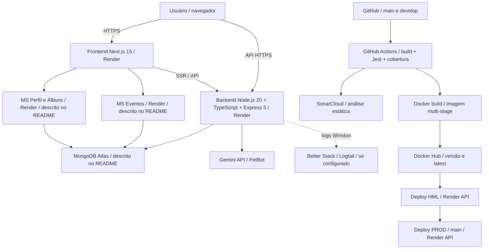
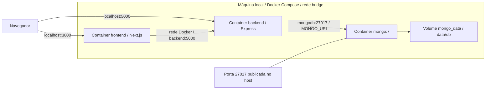
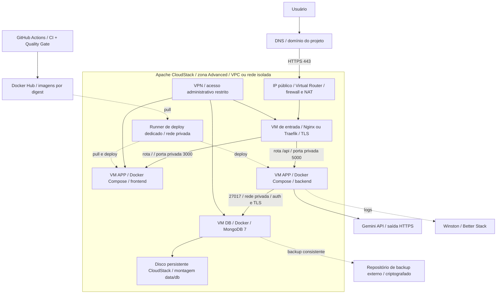
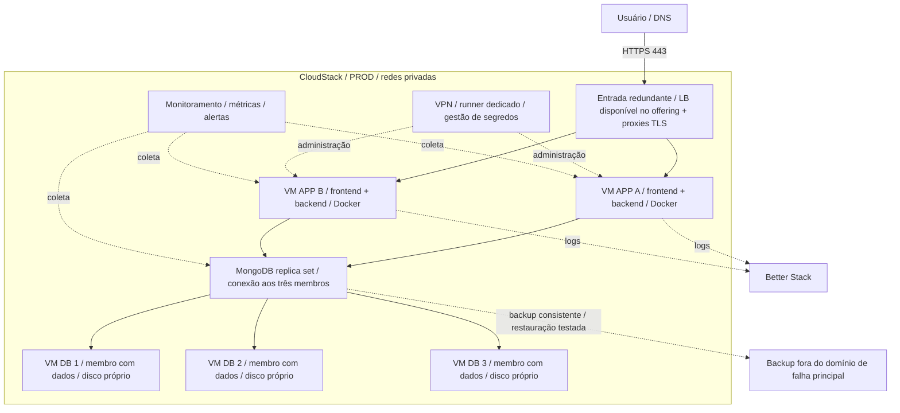
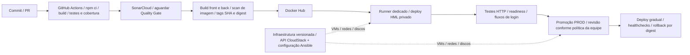

# Pet Joyful — arquitetura atual e proposta em Apache CloudStack

Análise de 06/10/2026. Base: README.md, docker-compose.yml, Dockerfile, package.json, .github/workflows/ci.yml, sonar-project.properties, server.ts e backend/src. O estado dos serviços remotos não foi testado. Frontend e microsserviços externos são descritos pelo README; seus repositórios não foram inspecionados. Os três containers informados pelo usuário são o escopo inicial.

## 1. Ambiente atual: publicação descrita no README

O workflow publica a imagem do backend e solicita os deploys por API do Render. O sucesso dessa solicitação não comprova que o serviço ficou saudável. Não há espera explícita pelo Quality Gate na chamada do scanner. SonarCloud é o serviço de análise utilizado; hospedar SonarQube é uma opção futura, não um componente já implantado aqui.

Stack confirmada: Node.js 20, TypeScript 5, Express 5, Mongoose 8, MongoDB, JWT, bcrypt, Swagger, Jest/Supertest, Docker, Compose, GitHub Actions, Docker Hub, SonarCloud, Winston e Logtail. Gemini está integrado ao backend. Cloudinary aparece no histórico do README, mas não foi confirmado como integração deste backend.

## 2. Ambiente atual: containers locais

O Compose tem três serviços, restart policy e healthcheck do MongoDB. O frontend depende de um contexto externo (`FRONTEND_CONTEXT`, padrão `./frontend`). Há código de gateway e messages-service no repositório, mas eles não são containers separados nesse Compose. O gateway contém destinos localhost; não deve ser tratado como gateway pronto para a nuvem.

## 3. Primeira implantação recomendada no CloudStack

Pré-requisito: acesso a uma nuvem CloudStack existente, da instituição ou de um provedor. Apache CloudStack é software IaaS, não uma conta de hospedagem gratuita fornecida pela Apache. Se for instalado do zero, são necessários servidores/hypervisores, armazenamento e rede, além de operação da plataforma.

Essa etapa usa três VMs por ambiente: entrada, aplicação e banco. É simples de operar, mas cada VM é um ponto único de falha. Compose não agenda containers em vários hosts e `restart` não garante alta disponibilidade. HML deve ter rede, banco, credenciais e domínio separados de PROD; pode usar menos recursos.

CloudStack fornece VMs, discos e redes. Docker/Compose e Nginx/Traefik são instalados nas VMs. Firewall, NAT, VPN e balanceamento dependem do network offering e do provedor; validar o suporte antes de provisionar. Não presumir um balanceador HTTP/TLS gerenciado em toda instalação.

## 4. Arquitetura alvo: alta disponibilidade

Recomendação: dois hosts de aplicação e três membros MongoDB com dados, distribuídos em hosts físicos/domínios de falha distintos mediante anti-affinity e capacidade real do provedor. Um único host físico com cinco VMs não fornece essa proteção. A camada de entrada também precisa redundância; validar VR redundante e mecanismo de failover do provedor. O diagrama não garante sobrevivência à perda de uma zona: recuperação entre zonas exige projeto e teste próprios.

Cada MongoDB mantém disco próprio; não compartilhar o mesmo `/data/db` entre membros. Configurar replica set, autenticação entre membros, usuário da aplicação com privilégio mínimo, TLS e URI com os três endereços e `replicaSet`. Replicação não substitui backup. Usar backups consistentes do banco e cópias externas; snapshots de VM/disco são proteção complementar.

Compose pode permanecer por VM com automação explícita para retirar uma instância do balanceador, atualizar, verificar readiness e devolver ao tráfego. Kubernetes/k3s é uma evolução opcional quando a equipe precisar de agendamento, rolling updates e escala automática; não é requisito para hospedar os três containers. Instalar Kubernetes acrescenta operação e não elimina a necessidade de discos, backup e recuperação do MongoDB.

## 5. CI/CD ideal ligado à infraestrutura

Manter a imagem aprovada entre HML e PROD quando a configuração permitir; evitar `latest` como identidade de release. Preferir frontend chamando `/api` na mesma origem, com proxy para o backend, para facilitar a promoção. Se usar URL pública absoluta em `NEXT_PUBLIC_API_URL`, ela precisa estar correta no build Next.js. Separar URL pública do navegador e URL interna de SSR. Nunca passar segredos em `NEXT_PUBLIC_*`.

O runner dedicado precisa alcançar a rede privada e ter permissão limitada ao deploy; não executar código de PR não confiável nele. Substituir os jobs que chamam Render por deploy nessa rede. Versionar provisionamento e configuração antes de automatizar alterações na infraestrutura.

## 6. O que precisa mudar antes do primeiro deploy

1. **Conectividade frontend:** `NEXT_PUBLIC_API_URL=http://backend:5000` é nome interno do Docker, inacessível ao navegador do usuário. Confirmar o código do frontend e adotar `/api` ou domínio HTTPS público correto no build.
2. **Banco privado:** retirar a publicação pública de 27017. Backend não deve usar usuário root do MongoDB como no Compose atual; criar usuário da aplicação.
3. **Persistência:** montar disco de dados provisionado e registrar o caminho de montagem. Um volume Docker na VM não cria automaticamente backup ou proteção contra perda da VM/disco.
4. **Saúde real:** hoje `/` responde mesmo quando o MongoDB falha, pois `server.ts` inicia o servidor antes da conexão. Criar liveness e readiness, com readiness verificando a conexão ao banco; só promover instâncias prontas.
5. **CORS e proxy:** parametrizar origens para os novos domínios e validar headers/HTTPS do proxy. O arquivo atual contém origens fixas locais/Render.
6. **Serviços de negócio:** validar dependências de eventos, perfil e posts antes de desligar Render. Os três containers não incluem automaticamente esses microsserviços. Se usados pelo front, migrá-los ou manter seus endpoints externos temporariamente.
7. **Secrets:** manter JWT, MongoDB, Gemini, Logtail e credenciais do registro fora de imagens/Git; separar por ambiente e controlar o acesso ao runner e às VMs.
8. **Observabilidade:** conservar Winston/Better Stack e acrescentar métricas de VM, disco, containers, HTTP e MongoDB, alertando por indisponibilidade, erro, latência e falta de espaço.
9. **Migração:** inventariar dados Atlas, fazer backup, ensaiar restauração em HML, planejar corte das escritas, importar e validar. Não manter bancos divergentes após o corte.
10. **Recuperação:** documentar retenção e executar restauração de banco e rollback de aplicação. Os RNFs 99,9% e recuperação menor que 5 minutos do README são metas a comprovar; os arquivos não demonstram seu atendimento.

## 7. Dimensionamento inicial e critérios de aceite

Estimativas para piloto de baixo tráfego, não sizing baseado em medições: VM entrada 1–2 vCPU e 1–2 GiB RAM; VM APP 2–4 vCPU e 4–8 GiB; VM MongoDB 2–4 vCPU e 4–8 GiB, disco SSD inicialmente 30–50 GiB ajustado ao volume real. HML separado pode ser menor. Na arquitetura HA, repetir a capacidade por nó de aplicação/banco, incluindo espaço de backup e crescimento. Não há estimativa de preço sem provedor, cotas e carga.

Aceite: domínio HTTPS válido; nenhum acesso público ao MongoDB; login e fluxos de negócio funcionais; persistência após recriação do container; readiness detectando banco indisponível; backup restaurado em ambiente isolado; rollback validado; HML/PROD separados; alarmes acionados em teste. Para HA, também testar perda de VM, eleição do MongoDB, falha da entrada e distribuição dos hosts físicos.

Ordem: obter acesso/cotas CloudStack → redes/discos/VMs HML → configurar Docker e proxy → corrigir conectividade e readiness → publicar imagens → ensaiar dados e recuperação → automatizar CI/CD → provisionar PROD → migrar DNS/dados → evoluir HA com testes de carga e falha.

## 8. Oracle Cloud como alternativa

O desenho lógico se mantém: VPC/rede isolada vira VCN com sub-redes; VMs viram OCI Compute; disco vira Block Volume; backups podem usar Object Storage; entrada pode usar serviço de load balancing; segredos podem usar Vault. Este é apenas um mapeamento conceitual, sem validação de oferta, custos ou elegibilidade. Prioridade recomendada: CloudStack existente; se não houver infraestrutura disponível, comparar um provedor CloudStack com OCI antes de instalar uma nuvem própria.

## Referências oficiais

- [Apache CloudStack — plataforma IaaS](https://cloudstack.apache.org/about/)
- [CloudStack — redes, VPC e serviços de rede](https://docs.cloudstack.apache.org/en/4.19.3.0/adminguide/networking_and_traffic.html)
- [CloudStack — armazenamento e snapshots](https://docs.cloudstack.apache.org/en/latest/adminguide/storage.html)
- [CloudStack — backup e recovery e dependência de providers](https://docs.cloudstack.apache.org/en/latest/adminguide/backup_and_recovery.html)
- [MongoDB — replica set de três membros](https://www.mongodb.com/docs/manual/core/replica-set-architecture-three-members/)
- [Next.js — variáveis públicas embutidas no build](https://nextjs.org/docs/pages/guides/environment-variables)
