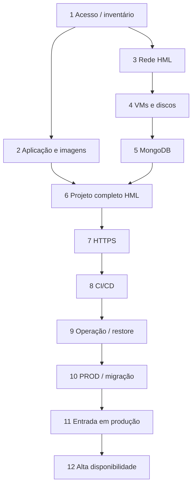
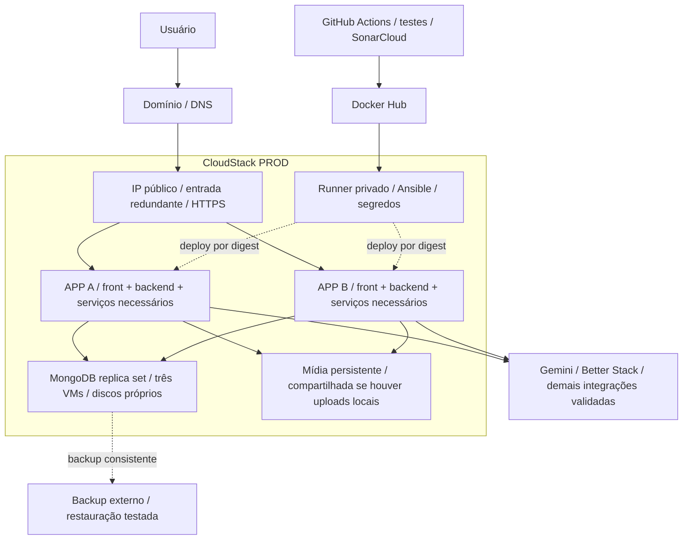

# Pet Joyful — passo a passo para hospedar o projeto completo

Proposta de execução em Apache CloudStack · 06/10/2026. Complementa [a arquitetura atual e ideal](arquitetura-cloudstack.md). Este roteiro não executou deploy e não pressupõe credenciais ou infraestrutura disponíveis. O código de front e serviços externos ainda precisa ser verificado.

## Resultado esperado

Frontend, backend principal, MongoDB e todos os microsserviços necessários executam em VMs da nuvem CloudStack. O usuário usa um domínio HTTPS; banco e APIs internas ficam em rede privada. GitHub Actions publica imagens e automatiza entrega. Gemini, Docker Hub, SonarCloud e Better Stack podem continuar como serviços externos em nuvem. “Projeto inteiro hospedado” não exige instalar esses SaaS dentro do CloudStack.

## Sequência e dependências

Primeiro marco: projeto funcional em HML. Segundo: produção com dados migrados, backups e deploy automático. Terceiro: alta disponibilidade validada. Se 99,9% e recuperação menor que 5 minutos forem requisitos obrigatórios de lançamento, concluir a etapa 12 em PROD antes de abrir o tráfego da etapa 11.

## 1. Definir acesso e escopo

**Execução:** Confirmar nuvem CloudStack da instituição/provedor, conta, zona, cotas, IP público, domínio, orçamento e responsável pela operação. Inventariar frontend, backend, MongoDB, eventos, perfil/álbuns e uploads.

**Tecnologias:** CloudStack / GitHub / inventário de dependências.

**Desafio e tratamento:** CloudStack precisa de infraestrutura disponível; os três containers não cobrem necessariamente todas as funções.

**Critério para avançar:** Acesso e capacidade confirmados; lista de serviços e dados aprovada.

## 2. Preparar aplicação e imagens

**Execução:** Criar configuração de produção; revisar URL pública e SSR do Next.js, CORS, health/readiness, POSTS_SERVICE_URL, encerramento gracioso e secrets. Containerizar serviços externos usados. Publicar imagens com SHA/digest.

**Tecnologias:** Docker / Next.js / Express / Mongoose / Docker Hub.

**Desafio e tratamento:** Nome Docker não resolve no navegador; localhost entre VMs não representa outro serviço. Variáveis NEXT_PUBLIC podem estar congeladas no build.

**Critério para avançar:** Cada imagem inicia com configuração externa e todos os fluxos funcionam em ensaio local.

## 3. Criar a rede de homologação

**Execução:** Criar VPC e tiers entrada/app/dados quando disponíveis; alternativa: rede isolada com regras CloudStack e firewall nas VMs. Reservar IP público, configurar NAT e acesso administrativo VPN. Definir DNS HML.

**Tecnologias:** CloudStack Virtual Router / ACL / NAT / VPN / DNS.

**Desafio e tratamento:** Serviços dependem do network offering; rede bridge Docker só conecta containers do mesmo host.

**Critério para avançar:** Somente entrada pública; backend e banco privados; administração acessível pela rota autorizada.

## 4. Provisionar VMs e discos

**Execução:** Criar VM EDGE, APP e DB com Linux suportado pelo provedor; instalar Docker/Compose e aplicar configuração reproduzível via Ansible. Criar disco de dados separado, montar persistentemente e limitar logs.

**Tecnologias:** CloudStack Compute e volumes / Linux / Docker Compose / Ansible.

**Desafio e tratamento:** Cotas, CPU/RAM, IOPS e montagem após reboot; volume Docker sozinho não protege o host.

**Critério para avançar:** Reboot mantém montagem e serviços; capacidade e permissões verificadas.

## 5. Implantar MongoDB

**Execução:** Iniciar banco em rede privada, criar usuário limitado da aplicação, configurar autenticação/TLS, disco próprio e backup. Para o alvo HA, configurar três membros com dados em hosts físicos distintos.

**Tecnologias:** MongoDB / MongoDB Database Tools / disco persistente.

**Desafio e tratamento:** Versão/FCV da origem devem ser compatíveis com destino; mongo:7 do Compose não prova compatibilidade com Atlas.

**Critério para avançar:** Conexão privada funciona; recriação do container mantém dados; restauração isolada concluída.

## 6. Implantar o projeto completo em HML

**Execução:** Subir front, back e todos os serviços de eventos/perfil/posts necessários. Ajustar URLs internas para endereços privados ou DNS interno. Conectar banco HML e saída para Gemini/Logtail; validar destino dos uploads.

**Tecnologias:** Docker Compose / Next.js / Express / serviços do projeto.

**Desafio e tratamento:** Imagens adicionais e contratos de API precisam ser verificados nos outros repositórios. Arquivos de upload locais exigem armazenamento persistente/compartilhado.

**Critério para avançar:** Login, usuários, posts, mensagens, eventos, perfil, álbuns e IA usados pelo projeto funcionam em HML.

## 7. Publicar entrada HTTPS

**Execução:** Configurar Nginx: / para frontend; /api para backend principal; rotas dos demais serviços com prefixos sem conflito. Emitir certificado e configurar renovação. Manter 3000/5000/27017 sem acesso público.

**Tecnologias:** Nginx / TLS / DNS / ACME se aplicável.

**Desafio e tratamento:** Proxy deve preservar ou remover prefixos conforme a API. Validação ACME depende de DNS ou porta 80 controlada.

**Critério para avançar:** HTTPS válido, renovação ensaiada e acesso pelo navegador sem erros de CORS ou conteúdo misto.

## 8. Automatizar release

**Execução:** Manter Actions com build/testes/cobertura e SonarCloud; aguardar Quality Gate; produzir imagens por digest. Runner dedicado privado instala release em HML, valida e promove PROD com rollback. Substituir chamadas Render.

**Tecnologias:** GitHub Actions / SonarCloud / Docker Hub / runner privado / Ansible.

**Desafio e tratamento:** Evitar código não confiável no runner; imagem Next.js deve permitir promoção ou ser construída com configuração pública por ambiente.

**Critério para avançar:** Release HML comprovada; falha de readiness impede promoção; rollback de aplicação testado.

## 9. Instrumentar e ensaiar operação

**Execução:** Centralizar logs Winston/Better Stack; acrescentar Prometheus/Grafana e exporters se a equipe optar por operar métricas, ou serviço equivalente. Alertar HTTP, disco, memória, containers e banco. Definir RPO/RTO e retenção.

**Tecnologias:** Winston / Better Stack / métricas / backup externo.

**Desafio e tratamento:** Logs não substituem métricas. Backup deve ser consistente, protegido e restaurável; metas de RPO/RTO exigem validação.

**Critério para avançar:** Indisponibilidade gera alerta; restore e rollback cronometrados atendem às metas escolhidas.

## 10. Preparar produção e migrar dados

**Execução:** Reproduzir infraestrutura PROD com segredos próprios. Ensaiar dump/restore e medir janela. No corte, bloquear escritas na origem por todas as aplicações, gerar backup final consistente, restaurar e validar índices, documentos e relações.

**Tecnologias:** CloudStack PROD / mongodump / mongorestore / DNS.

**Desafio e tratamento:** Cópia com escritas ativas pode ser inconsistente. Não planejar migração sem conhecer tamanho, versão, permissões e origem real.

**Critério para avançar:** Validação pré-abertura completa; backup final preservado e plano de retorno definido.

## 11. Entrar em produção

**Execução:** Redirecionar domínio para entrada CloudStack e abrir tráfego/escritas somente no destino. Monitorar erros e fluxos; manter origem preservada e sem escritas durante observação; desativar legado após aceite.

**Tecnologias:** DNS / Nginx / CloudStack / monitoramento.

**Desafio e tratamento:** DNS pode ficar em cache. Após novas escritas no destino, voltar ao banco antigo exige reconciliar dados; rollback de imagem é diferente de rollback de banco.

**Critério para avançar:** Usuários acessam o projeto completo; todas as APIs/dados necessários estão no destino; alertas e backups operam.

## 12. Chegar ao alvo de alta disponibilidade

**Execução:** Adicionar APP B, MongoDB com três membros e entrada redundante; distribuir em hosts físicos diferentes e atualizar balanceamento. Validar estado compartilhado de uploads, caches Next.js e sessões; realizar testes de carga/falha.

**Tecnologias:** CloudStack anti-affinity / balanceamento / Docker / MongoDB replica set.

**Desafio e tratamento:** Mais VMs no mesmo host não entregam tolerância à falha física. Compose exige automação por host; Kubernetes é evolução opcional.

**Critério para avançar:** Perda de APP/DB/entrada testada sem exceder metas; nenhuma dependência de armazenamento local impede failover.

## Regras de comunicação da rede

- Internet → entrada: HTTPS 443; HTTP 80 apenas para redirecionamento/validação de certificado quando necessário.
- Entrada → APP: 3000 frontend e 5000 backend, liberadas apenas da entrada. Rotas/portas dos demais serviços serão definidas pelo inventário.
- APP/serviços autorizados → DB: 27017 privado; membros MongoDB também precisam comunicar entre si na rede privada.
- Administração → VMs: SSH 22 via VPN e origem restrita; runner só acessa hosts de deploy autorizados.
- VMs → serviços externos: saída controlada para registry, GitHub, certificados, atualizações, Gemini e Logtail conforme necessários.
- Demais acessos: negar por padrão. HML não deve acessar o banco PROD.

## Arquitetura final do tráfego

APP A/B podem hospedar as réplicas dos serviços em Compose por host; separar serviços em VMs adicionais depende de carga e isolamento necessários. Se o provedor não oferecer armazenamento de mídia compartilhado, escolher um serviço externo apropriado ou provisionar solução operada pela equipe antes de escalar. Não presumir Cloudinary implementado apenas por aparecer no histórico do README.

## Entregáveis técnicos previstos

- Manifestos Compose de aplicação e banco separados, com imagens versionadas, healthchecks e configurações por ambiente.
- Configuração Nginx/TLS com mapa de rotas e renovação.
- Inventário/playbooks Ansible e definição versionada de redes, VMs e discos via API CloudStack; Terraform é opcional após verificar provider compatível com a instalação.
- Pipeline de CI/CD e release manifest contendo digests de todos os serviços.
- Procedimentos de migração, backup/restore, rollback, alerta e resposta a falhas.

Não gerar segredos reais em exemplos. IPs, domínios, cotas, versões e tempos serão definidos após acesso ao provedor e ensaio. Responsabilidades sugeridas: infraestrutura cuida de rede/VMs; desenvolvimento prepara serviços; DevOps cuida de pipeline/observabilidade; responsável pelo banco valida migração e restore. Uma mesma pessoa pode acumular funções.

## Fontes e limites

Base local: README, Compose, Dockerfile, workflow e código do backend revisados na análise anterior. Os arquivos atuais indicam SonarCloud, não servidor SonarQube. O roadmap é uma proposta, não comprovação de disponibilidade ou deploy.

- [CloudStack — VPC e regras de rede](https://docs.cloudstack.apache.org/en/4.16.1.0/adminguide/networking/virtual_private_cloud_config.html): validar a documentação da versão do provedor.
- [MongoDB — ferramentas de backup e consistência](https://www.mongodb.com/docs/v8.0/tutorial/backup-and-restore-tools/): recursos como oplog dependem da topologia e permissões; a proposta inicial usa janela sem escritas.
- [MongoDB — compatibilidade de restauração](https://www.mongodb.com/docs/database-tools/mongorestore/mongorestore-behavior-access-usage/).
- [Next.js — variáveis no build](https://nextjs.org/docs/pages/guides/environment-variables).
